## Part 1. Запуск нескольких docker-контейнеров с использованием docker compose

1) Написать Dockerfile для каждого отдельного микросервиса. Необходимые зависимости описаны в материалах. В отчете отобразить размер собранных образов любого сервиса различными способами.

- Пример Dockerfile для booking сервиса. Другие Dockerfile'ы отличаются только другим портом (строчка EXPOSE) и ожиданием других сервисов (в строчке CMD)
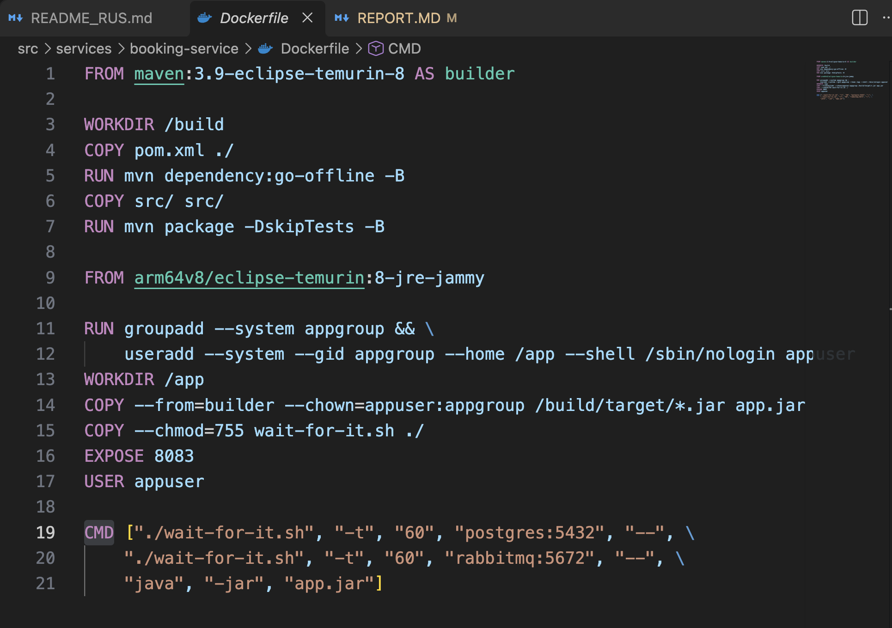

### Сравнение обычной сборки от multistage
- Dockerfile с обычной сборкой
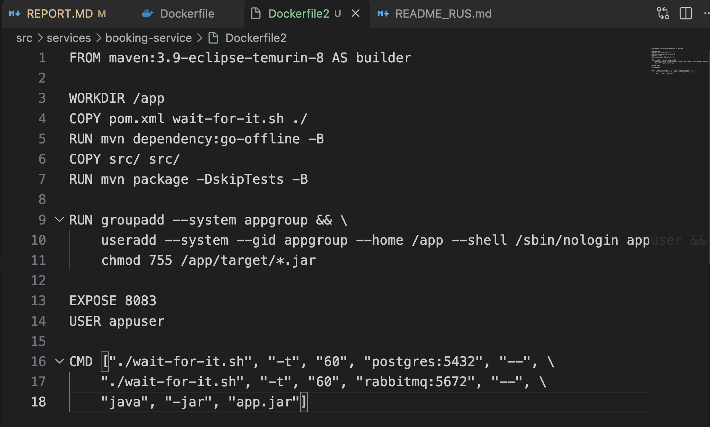
- Размер обычной сборки

- Размер multistage сборки 
**РАЗНИЦА почти в 2,5 раза!**


2) Написать docker-compose файл который осуществляет корректное взаимодействие сервисов. Пробросить порты для доступа к gateway service и session service из локальной машины. Помощь по docker compose в материалах.
```
services:
  postgres:
    image: postgres:18.4-alpine3.23
    environment:
      POSTGRES_USER: ${POSTGRES_USER}
      POSTGRES_PASSWORD: ${POSTGRES_PASSWORD}
      POSTGRES_DB: ${POSTGRES_DB}
    restart: unless-stopped
    expose:
      - 5432
    healthcheck:
      test: ["CMD", "pg_isready", "-U", "postgres"]
      interval: 10s
      timeout: 5s
      retries: 5
      start_period: 10s
    volumes:
      - ./services/database/init.sql:/docker-entrypoint-initdb.d/init.sql:ro
      - pg_data:/var/lib/postgresql
    networks:
      - services_network
  rabbitmq:
    image: rabbitmq:3-management-alpine
    environment:
      RABBIT_MQ_HOST: ${RABBIT_MQ_HOST}
      RABBIT_MQ_PASSWORD: ${RABBIT_MQ_PASSWORD}
    restart: unless-stopped
    expose:
      - 5672
    healthcheck:
      test: ["CMD", "rabbitmq-diagnostics", "ping"]
      interval: 10s
      timeout: 5s
      retries: 5
      start_period: 5s
    volumes:
      - rabbitmq_data:/var/lib/rabbitmq
    networks:
      - services_network

  session-service:
    build: ./services/session-service
    environment:
      POSTGRES_HOST: ${POSTGRES_HOST}
      POSTGRES_PORT: ${POSTGRES_PORT}
      POSTGRES_USER: ${POSTGRES_USER}
      POSTGRES_PASSWORD: ${POSTGRES_PASSWORD}
      POSTGRES_DB: ${POSTGRES_DB}
    ports:
      - "8081:8081"
    depends_on:
      postgres:
        condition: service_healthy
    networks:
      - services_network

  hotel-service:
    build: ./services/hotel-service
    environment:
      POSTGRES_HOST: ${POSTGRES_HOST}
      POSTGRES_PORT: ${POSTGRES_PORT}
      POSTGRES_USER: ${POSTGRES_USER}
      POSTGRES_PASSWORD: ${POSTGRES_PASSWORD}
      POSTGRES_DB: ${POSTGRES_DB}
    expose:
      - 8082
    depends_on:
      postgres:
        condition: service_healthy
    networks:
      - services_network

  booking-service:
    build: ./services/booking-service
    environment:
      POSTGRES_HOST: ${POSTGRES_HOST}
      POSTGRES_PORT: ${POSTGRES_PORT}
      POSTGRES_USER: ${POSTGRES_USER}
      POSTGRES_PASSWORD: ${POSTGRES_PASSWORD}
      POSTGRES_DB: ${POSTGRES_DB}
      RABBIT_MQ_HOST: ${RABBIT_MQ_HOST}
      RABBIT_MQ_PORT: ${RABBIT_MQ_PORT}
      RABBIT_MQ_USER: ${RABBIT_MQ_USER}
      RABBIT_MQ_PASSWORD: ${RABBIT_MQ_PASSWORD}
      RABBIT_MQ_QUEUE_NAME: ${RABBIT_MQ_QUEUE_NAME}
      RABBIT_MQ_EXCHANGE: ${RABBIT_MQ_EXCHANGE}
      HOTEL_SERVICE_HOST: ${HOTEL_SERVICE_HOST}
      HOTEL_SERVICE_PORT: ${HOTEL_SERVICE_PORT}
      PAYMENT_SERVICE_HOST: ${PAYMENT_SERVICE_HOST}
      PAYMENT_SERVICE_PORT: ${PAYMENT_SERVICE_PORT}
      LOYALTY_SERVICE_HOST: ${LOYALTY_SERVICE_HOST}
      LOYALTY_SERVICE_PORT: ${LOYALTY_SERVICE_PORT}
    expose:
      - 8083
    depends_on:
      postgres:
        condition: service_healthy
      rabbitmq:
        condition: service_healthy
    networks:
      - services_network

  payment-service:
    build: ./services/payment-service
    environment:
      POSTGRES_HOST: ${POSTGRES_HOST}
      POSTGRES_PORT: ${POSTGRES_PORT}
      POSTGRES_USER: ${POSTGRES_USER}
      POSTGRES_PASSWORD: ${POSTGRES_PASSWORD}
      POSTGRES_DB: ${POSTGRES_DB}
    expose:
      - 8084
    depends_on:
      postgres:
        condition: service_healthy
    networks:
      - services_network

  loyalty-service:
    build: ./services/loyalty-service
    environment:
      POSTGRES_HOST: ${POSTGRES_HOST}
      POSTGRES_PORT: ${POSTGRES_PORT}
      POSTGRES_USER: ${POSTGRES_USER}
      POSTGRES_PASSWORD: ${POSTGRES_PASSWORD}
      POSTGRES_DB: ${POSTGRES_DB}
    expose:
      - 8085
    depends_on:
      postgres:
        condition: service_healthy
    networks:
      - services_network

  report-service:
    build: ./services/report-service
    environment:
      POSTGRES_HOST: ${POSTGRES_HOST}
      POSTGRES_PORT: ${POSTGRES_PORT}
      POSTGRES_USER: ${POSTGRES_USER}
      POSTGRES_PASSWORD: ${POSTGRES_PASSWORD}
      POSTGRES_DB: ${POSTGRES_DB}
      RABBIT_MQ_HOST: ${RABBIT_MQ_HOST}
      RABBIT_MQ_PORT: ${RABBIT_MQ_PORT}
      RABBIT_MQ_USER: ${RABBIT_MQ_USER}
      RABBIT_MQ_PASSWORD: ${RABBIT_MQ_PASSWORD}
      RABBIT_MQ_QUEUE_NAME: ${RABBIT_MQ_QUEUE_NAME}
      RABBIT_MQ_EXCHANGE: ${RABBIT_MQ_EXCHANGE}
    expose:
      - 8086
    depends_on:
      postgres:
        condition: service_healthy
      rabbitmq:
        condition: service_healthy
    networks:
      - services_network

  gateway-service:
    build: ./services/gateway-service
    environment:
      SESSION_SERVICE_HOST: ${SESSION_SERVICE_HOST}
      SESSION_SERVICE_PORT: ${SESSION_SERVICE_PORT}
      HOTEL_SERVICE_HOST: ${HOTEL_SERVICE_HOST}
      HOTEL_SERVICE_PORT: ${HOTEL_SERVICE_PORT}
      BOOKING_SERVICE_HOST: ${BOOKING_SERVICE_HOST}
      BOOKING_SERVICE_PORT: ${BOOKING_SERVICE_PORT}
      PAYMENT_SERVICE_HOST: ${PAYMENT_SERVICE_HOST}
      PAYMENT_SERVICE_PORT: ${PAYMENT_SERVICE_PORT}
      LOYALTY_SERVICE_HOST: ${LOYALTY_SERVICE_HOST}
      LOYALTY_SERVICE_PORT: ${LOYALTY_SERVICE_PORT}
      REPORT_SERVICE_HOST: ${REPORT_SERVICE_HOST}
      REPORT_SERVICE_PORT: ${REPORT_SERVICE_PORT}
    ports:
      - "8087:8087"
    networks:
      - services_network

networks:
  services_network:
    driver: bridge
  
volumes:
  pg_data:
  rabbitmq_data:
```

3) Собрать и развернуть веб-сервис с помощью написанного docker compose файла на локальной машине.
- Запуск docker compose в фоне и вывод запущенных контейнеров
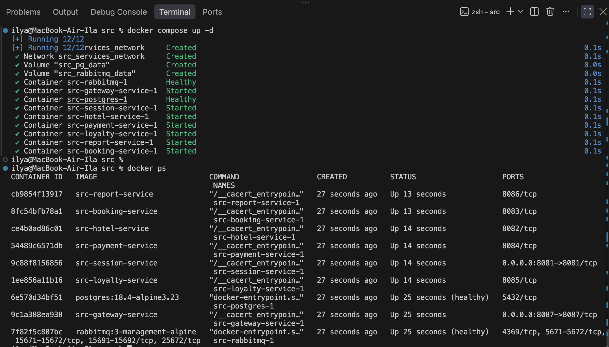

4) Прогнать заготовленные тесты через postman и удостовериться, что все они проходят успешно. Инутсрукцию по запуску тестов можно найти в материалах. В отчете отобразить результаты тестирования.
- Все тесты прошли успешно
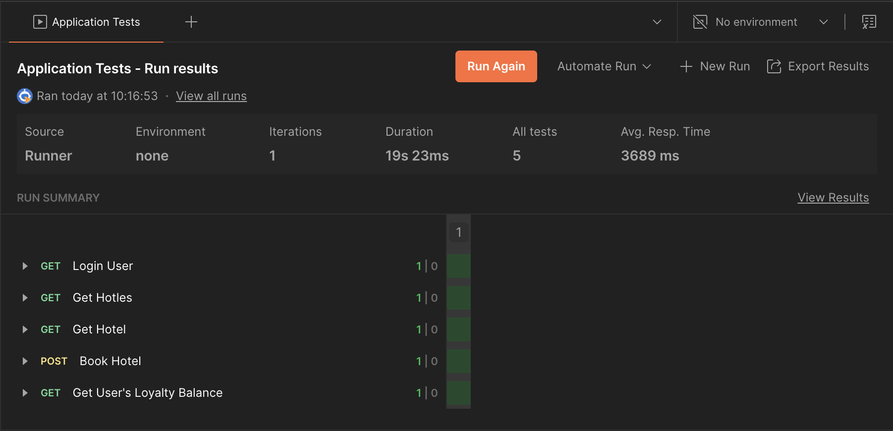

## Part 2. Создание виртуальных машин

1) Установить и инициализировать Vagrant в корне проекта. Написать Vagrantfile для одной виртуальной машины. Перенести в виртуальную машину исходный код веб-сервиса в рабочую директорию виртуальной машины. Помощь по vagrant в материалах.
- Содержимое моего vagrant файла. Я использовал образ bento/ubuntu-24.04, т.к. у меня macbook на m1 процессоре (архитектура arm64)
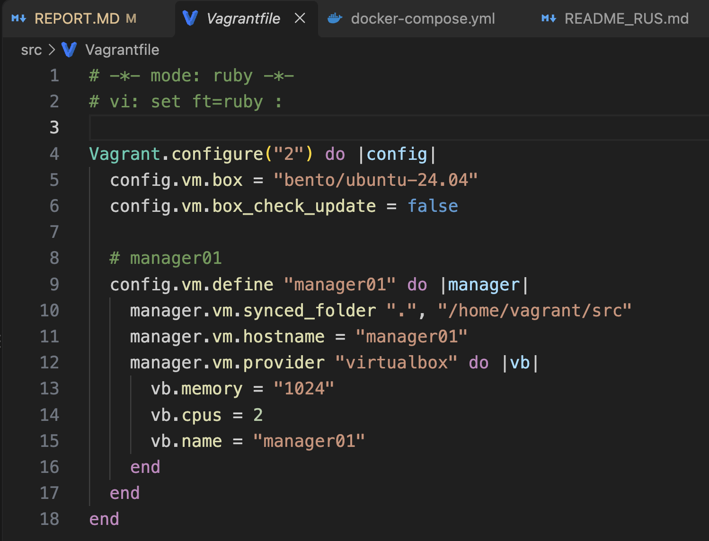
- Запуск ВМ
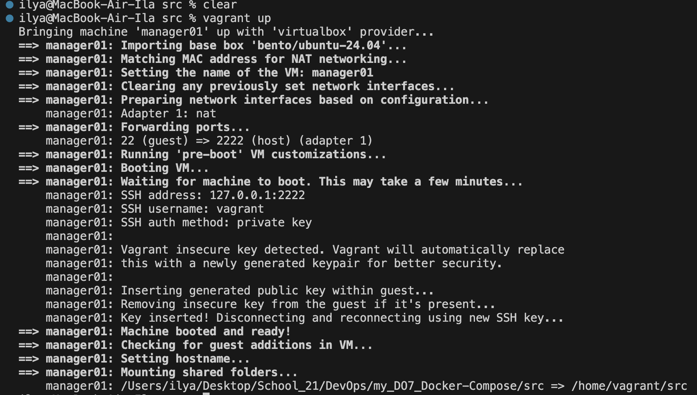

2) Зайти через консоль внутрь виртуальной машины и удостовериться, что исходный код встал куда нужно. Остановить и уничтожить виртуальную машину.
- Запуск виртуальной машигы с данным проектом внутри
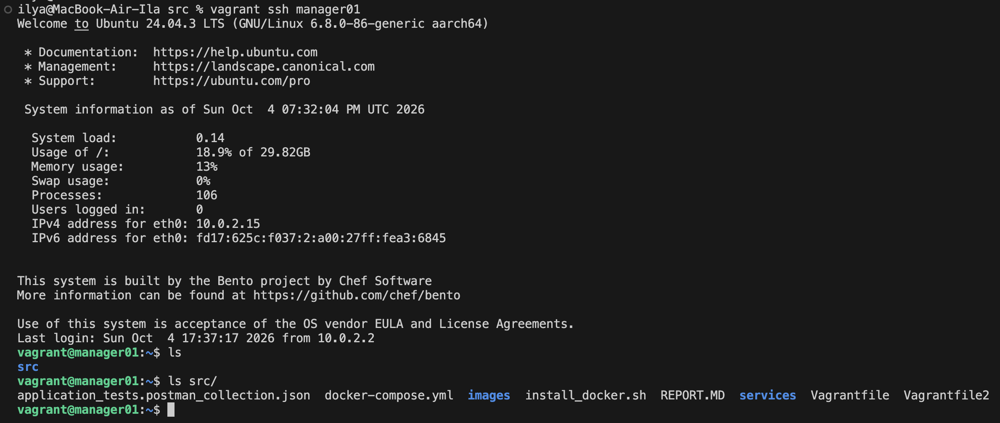
- Остановка и удаление машины
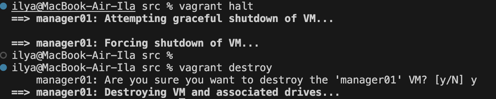

## Part 3. Создание простейшего docker swarm

1) Модифицировать Vagrantfile для создания трех машин: manager01, worker01, worker02. Написать shell-скрипты для установки docker внутрь машин, инициализации и подключения к docker swarm Помощь с docker swarm материалах.

Новый docker-compose.yml
```
services:
  postgres:
    image: postgres:18.4-alpine3.23
    environment:
      POSTGRES_USER: ${POSTGRES_USER}
      POSTGRES_PASSWORD: ${POSTGRES_PASSWORD}
      POSTGRES_DB: ${POSTGRES_DB}
    restart: unless-stopped
    healthcheck:
      test: ["CMD", "pg_isready", "-U", "postgres"]
      interval: 10s
      timeout: 5s
      retries: 5
      start_period: 10s
    volumes:
      - ./services/database/init.sql:/docker-entrypoint-initdb.d/init.sql:ro
      - pg_data:/var/lib/postgresql
    networks:
      - services_network
    deploy:
      replicas: 1
      placement:
        constraints:
          - node.role == manager
  rabbitmq:
    image: rabbitmq:3-management-alpine
    environment:
      RABBIT_MQ_HOST: ${RABBIT_MQ_HOST}
      RABBIT_MQ_PASSWORD: ${RABBIT_MQ_PASSWORD}
    restart: unless-stopped
    healthcheck:
      test: ["CMD", "rabbitmq-diagnostics", "ping"]
      interval: 10s
      timeout: 5s
      retries: 5
      start_period: 5s
    volumes:
      - rabbitmq_data:/var/lib/rabbitmq
    networks:
      - services_network
    deploy:
      replicas: 1
      placement:
        constraints:
          - node.role == manager

  session-service:
    image: shanteve/session-service:1.0
    environment:
      POSTGRES_HOST: ${POSTGRES_HOST}
      POSTGRES_PORT: ${POSTGRES_PORT}
      POSTGRES_USER: ${POSTGRES_USER}
      POSTGRES_PASSWORD: ${POSTGRES_PASSWORD}
      POSTGRES_DB: ${POSTGRES_DB}
    networks:
      - services_network

  hotel-service:
    image: shanteve/hotel-service:1.0
    environment:
      POSTGRES_HOST: ${POSTGRES_HOST}
      POSTGRES_PORT: ${POSTGRES_PORT}
      POSTGRES_USER: ${POSTGRES_USER}
      POSTGRES_PASSWORD: ${POSTGRES_PASSWORD}
      POSTGRES_DB: ${POSTGRES_DB}
    networks:
      - services_network

  booking-service:
    image: shanteve/booking-service:1.0
    environment:
      POSTGRES_HOST: ${POSTGRES_HOST}
      POSTGRES_PORT: ${POSTGRES_PORT}
      POSTGRES_USER: ${POSTGRES_USER}
      POSTGRES_PASSWORD: ${POSTGRES_PASSWORD}
      POSTGRES_DB: ${POSTGRES_DB}
      RABBIT_MQ_HOST: ${RABBIT_MQ_HOST}
      RABBIT_MQ_PORT: ${RABBIT_MQ_PORT}
      RABBIT_MQ_USER: ${RABBIT_MQ_USER}
      RABBIT_MQ_PASSWORD: ${RABBIT_MQ_PASSWORD}
      RABBIT_MQ_QUEUE_NAME: ${RABBIT_MQ_QUEUE_NAME}
      RABBIT_MQ_EXCHANGE: ${RABBIT_MQ_EXCHANGE}
      HOTEL_SERVICE_HOST: ${HOTEL_SERVICE_HOST}
      HOTEL_SERVICE_PORT: ${HOTEL_SERVICE_PORT}
      PAYMENT_SERVICE_HOST: ${PAYMENT_SERVICE_HOST}
      PAYMENT_SERVICE_PORT: ${PAYMENT_SERVICE_PORT}
      LOYALTY_SERVICE_HOST: ${LOYALTY_SERVICE_HOST}
      LOYALTY_SERVICE_PORT: ${LOYALTY_SERVICE_PORT}
    networks:
      - services_network

  payment-service:
    image: shanteve/payment-service:1.0
    environment:
      POSTGRES_HOST: ${POSTGRES_HOST}
      POSTGRES_PORT: ${POSTGRES_PORT}
      POSTGRES_USER: ${POSTGRES_USER}
      POSTGRES_PASSWORD: ${POSTGRES_PASSWORD}
      POSTGRES_DB: ${POSTGRES_DB}
    networks:
      - services_network

  loyalty-service:
    image: shanteve/loyalty-service:1.0
    environment:
      POSTGRES_HOST: ${POSTGRES_HOST}
      POSTGRES_PORT: ${POSTGRES_PORT}
      POSTGRES_USER: ${POSTGRES_USER}
      POSTGRES_PASSWORD: ${POSTGRES_PASSWORD}
      POSTGRES_DB: ${POSTGRES_DB}
    networks:
      - services_network

  report-service:
    image: shanteve/report-service:1.0
    environment:
      POSTGRES_HOST: ${POSTGRES_HOST}
      POSTGRES_PORT: ${POSTGRES_PORT}
      POSTGRES_USER: ${POSTGRES_USER}
      POSTGRES_PASSWORD: ${POSTGRES_PASSWORD}
      POSTGRES_DB: ${POSTGRES_DB}
      RABBIT_MQ_HOST: ${RABBIT_MQ_HOST}
      RABBIT_MQ_PORT: ${RABBIT_MQ_PORT}
      RABBIT_MQ_USER: ${RABBIT_MQ_USER}
      RABBIT_MQ_PASSWORD: ${RABBIT_MQ_PASSWORD}
      RABBIT_MQ_QUEUE_NAME: ${RABBIT_MQ_QUEUE_NAME}
      RABBIT_MQ_EXCHANGE: ${RABBIT_MQ_EXCHANGE}
    networks:
      - services_network

  gateway-service:
    image: shanteve/gateway-service:1.0
    environment:
      SESSION_SERVICE_HOST: ${SESSION_SERVICE_HOST}
      SESSION_SERVICE_PORT: ${SESSION_SERVICE_PORT}
      HOTEL_SERVICE_HOST: ${HOTEL_SERVICE_HOST}
      HOTEL_SERVICE_PORT: ${HOTEL_SERVICE_PORT}
      BOOKING_SERVICE_HOST: ${BOOKING_SERVICE_HOST}
      BOOKING_SERVICE_PORT: ${BOOKING_SERVICE_PORT}
      PAYMENT_SERVICE_HOST: ${PAYMENT_SERVICE_HOST}
      PAYMENT_SERVICE_PORT: ${PAYMENT_SERVICE_PORT}
      LOYALTY_SERVICE_HOST: ${LOYALTY_SERVICE_HOST}
      LOYALTY_SERVICE_PORT: ${LOYALTY_SERVICE_PORT}
      REPORT_SERVICE_HOST: ${REPORT_SERVICE_HOST}
      REPORT_SERVICE_PORT: ${REPORT_SERVICE_PORT}
    networks:
      - services_network

  nginx:
    image: nginx:1.30-alpine3.23-slim
    volumes:
      - ./nginx.conf:/etc/nginx/nginx.conf:ro
    ports:
      - "8081:8081"
      - "8087:8087"
    deploy:
      replicas: 1
      placement:
        constraints:
          - node.role == manager

networks:
  services_network:
    driver: overlay
  
volumes:
  pg_data:
  rabbitmq_data:
```

3) Поднять виртуальные машины и перенести на менеджер docker-compose файл. Запустить стек сервисов используя написанный docker-compose файл.

- Запустил виртуальные машины с необходимыми скриптами
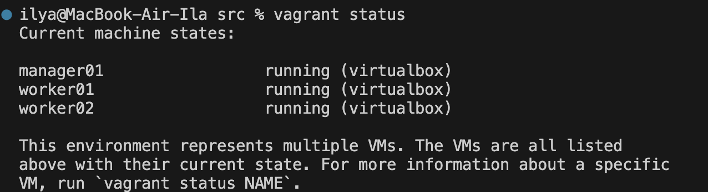

- Запуск стека сервисов
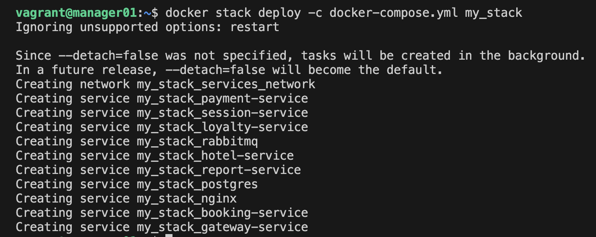

4) Настроить прокси на базе nginx для доступа к gateway service и session service по оверлейной сети. Сами gateway service и session service сделать недоступными напрямую.

- Я добавил nginx в docker compose и сделал gateway service и session service недоступными напрямую.
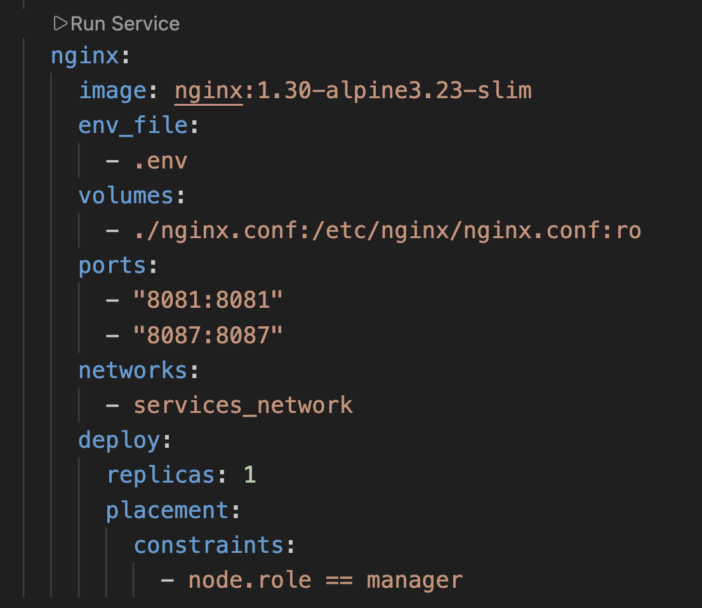

5) Прогнать заготовленные тесты через postman и удостовериться, что все они проходят успешно. В отчете отобразить результаты тестирования.

- Вначале я изменил API_HOST с localhost на 192.168.56.10 (это ip адрес моей машины manager01). Заново програл тесты. Все прошли успешно.
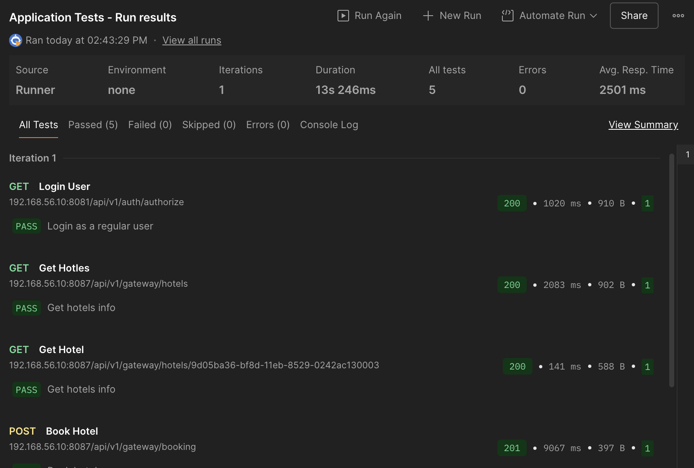

6) Используя команды docker отобразить в отчете распределение контейнеров по узлам.

- Список моих нод


- Распределение контейнеров по нодам
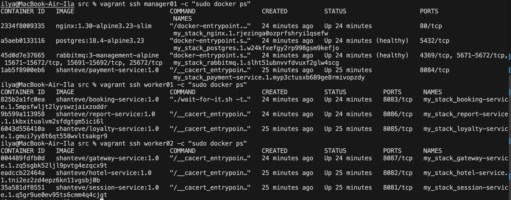

7) Установить отдельным стеком Portainer внутри кластера. В отчете отобразить визуализацию распределения задач по узлам с помощью Portainer.

- Запустил стек с Portainer


- Зашёл в логи сервиса portainer_portainer для того, чтобы скопировать setup token
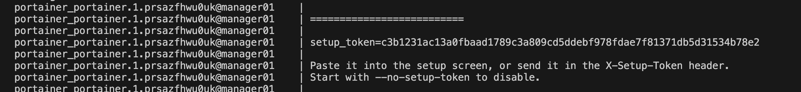

- Распределение задач по узлам
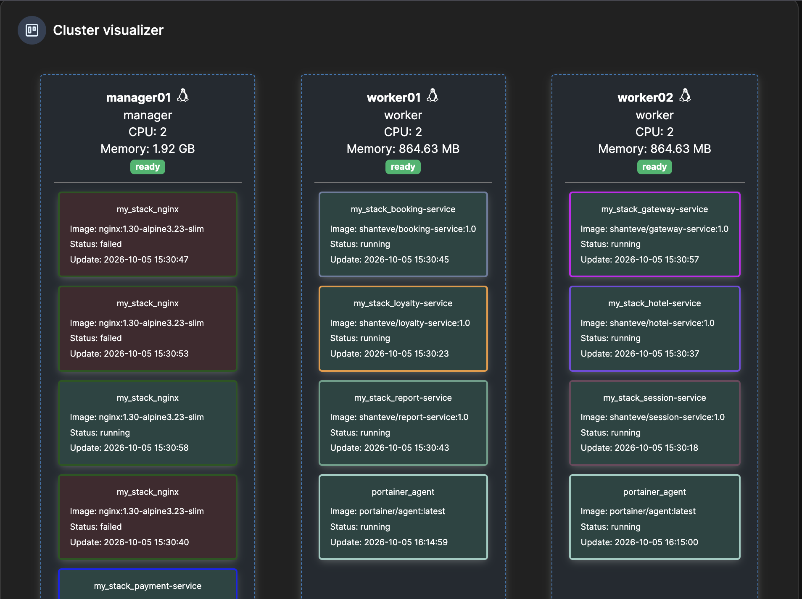
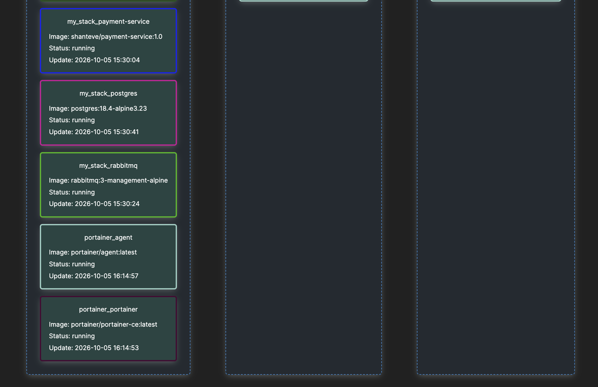